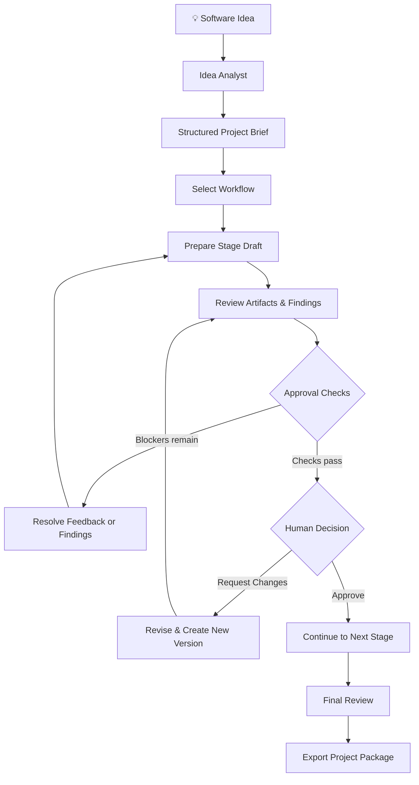
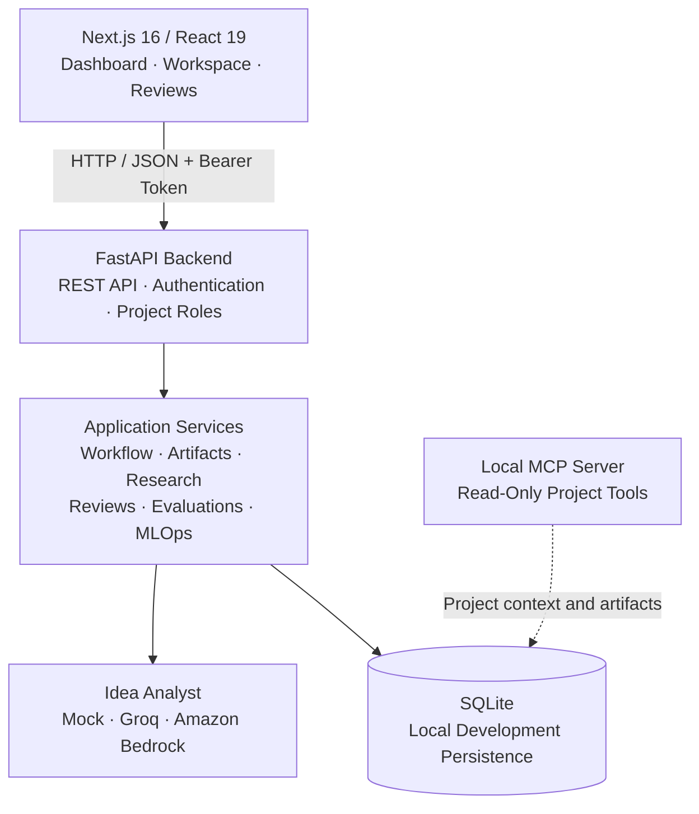

<div align="center">


<br/>

### From a raw idea to a structured, reviewable project plan.

**An AI-assisted project engineering workspace built around persistent workflows, versioned deliverables, human approvals, and traceable decisions.**

<br/>

<a href="https://github.com/RevHeadGuy/NexusFlow">

</a>
&nbsp;
<a href="docs/NexusFlow%20Architecture%20.png">

</a>
&nbsp;
<a href="docs/IMPLEMENTATION_PLAN.md#phase-roadmap">

</a>

<br/><br/>


</div>

---

> [!IMPORTANT]
> **Project status: local-first prototype.** NexusFlow includes email/password accounts, project roles, and collaborator invitations, but it is not production-hardened. Account recovery, email delivery, secure production session handling, database migrations, and other operational safeguards remain future work. Do not expose this prototype to the public internet as-is.

## Navigation

- [Why NexusFlow?](#-why-nexusflow)
- [Features](#-what-you-can-do)
- [How It Works](#-how-it-works)
- [Architecture](#-architecture)
- [Quick Start](#-quick-start)
- [Workflow & Approvals](#-workflow--human-approvals)
- [Team Collaboration](#-team-collaboration)
- [LLM Providers](#-llm-providers)
- [MCP Integration](#-local-mcp-integration)
- [API Reference](#-api-overview)
- [Testing](#-testing--quality)
- [Security & Limitations](#-security--limitations)
- [Roadmap](#-roadmap)
- [Documentation](#-documentation)

---

## 💡 Why NexusFlow?

A software idea is only the beginning.

Turning that idea into an implementation-ready project requires structured requirements, feasibility analysis, architecture decisions, reviewable documents, quality checks, and clear approval points.

NexusFlow brings these activities into one persistent workspace.

Instead of treating AI output as a finished answer, it treats project planning as a sequence of **artifacts, revisions, evaluations, and explicit human decisions**.

### The core idea

<div align="center">

<table>
<tr>
<td align="center" width="25%">


**Understand**

Structure the original idea into a project brief.

</td>
<td align="center" width="25%">


**Prepare**

Generate reviewable project planning documents.

</td>
<td align="center" width="25%">


**Evaluate**

Check content, feedback, and approval requirements.

</td>
<td align="center" width="25%">


**Decide**

Record human decisions and preserve revision history.

</td>
</tr>
</table>

</div>

## ✨ What You Can Do

<table>
<tr>
<td width="50%" valign="top">

### 🧠 Idea Analysis

- Turn a software idea into a structured brief.
- Use mock, Groq, or Amazon Bedrock provider options.
- Validate model output against a defined schema.
- Persist project context for subsequent stages.

</td>
<td width="50%" valign="top">

### 🔄 Persistent Workflows

- Select reusable workflow templates.
- Configure a project's stage sequence.
- Prepare stage-specific Markdown drafts.
- Resume work from saved workflow state.

</td>
</tr>
<tr>
<td width="50%" valign="top">

### 📝 Artifact Lifecycle

- Edit structured project documents.
- Save changes as durable artifact versions.
- Track review comments and suggested edits.
- Export project documentation and history.

</td>
<td width="50%" valign="top">

### 🛡️ Human-Controlled Quality

- Record approvals, rejections, and change requests.
- Run deterministic consistency evaluations.
- Inspect Devil's Advocate and guardrail findings.
- Prevent approval while configured blockers remain unresolved.

</td>
</tr>
<tr>
<td width="50%" valign="top">

### 👥 Project Collaboration

- Create accounts and sign in.
- Invite collaborators using single-use invitation links.
- Assign owner, editor, reviewer, or viewer roles.
- Enforce project membership and role checks through the API.

</td>
<td width="50%" valign="top">

### 🔌 Developer Integration

- Expose project context through a local MCP server.
- Read project metadata and artifact content.
- Inspect workflow history, runs, and metrics.
- Keep the MCP tools read-only in the current implementation.

</td>
</tr>
</table>

## 🧭 How It Works

The current implementation follows a persistent, human-reviewed project lifecycle.



### Important implementation distinction

NexusFlow is currently a **human-reviewed project planning workflow**, not a distributed multi-agent system.

The Idea Analyst is the only model-backed agent flow. Subsequent stages produce transparent planning drafts from saved project inputs; they do not represent independent autonomous agents collaborating. Research source discovery and verification are also not automated.

This distinction is intentional: workflow state, artifact revisions, evaluations, and approval decisions are persisted and reviewable rather than simulated as an autonomous multi-agent run.

---

## 🏗️ Architecture

<div align="center">

<a href="docs/NexusFlow%20Architecture%20.png">

</a>

<sub>Click the diagram to open the full architecture image.</sub>

<br/><br/>

<a href="docs/ARCHITECTURE.md">

</a>

</div>

### System overview



### Technology stack

| Layer | Technologies |
|---|---|
| Frontend | Next.js App Router, React, TypeScript, Tailwind CSS, shadcn/ui, Lucide |
| API | Python, FastAPI, Pydantic v2 |
| Persistence | SQLAlchemy 2, SQLite for documented local development |
| Idea Analysis | Mock provider, Groq, Amazon Bedrock |
| Workflow & Review | Persisted stage transitions, artifact versions, approval gates, review comments |
| Authentication | Email/password accounts, signed bearer tokens, project roles |
| Integration | Local MCP Streamable HTTP server with read-only tools |
| Quality | Deterministic evaluations, guardrails, backend tests, frontend build checks |

The backend is organized into `api/`, `agents/`, `guardrails/`, `models/`, `schemas/`, and `services/`.

The frontend lives under `frontend/src/app/`, with reusable components in `frontend/src/components/` and typed API clients in `frontend/src/lib/`.

### Persistence model

SQLite stores project and brief data, workflow plans and decisions, artifacts and versions, research sources, review comments, HITL checkpoints, guardrail findings, evaluations, traces, prompt versions, agent runs, accounts, project memberships, and invitation token hashes.

The application initializes tables at startup. A production database migration workflow is not included yet.

---

## 🚀 Quick Start

### Prerequisites

- Python **3.10+**
- Node.js **20.9+** and npm
- Optional: Groq API key or AWS credentials for live idea analysis

The default configuration uses a mock LLM provider, so you can start locally without cloud credentials.

### 1. Start the backend

Open a terminal from the repository root:

```bash
cd backend
cp ../.env.example .env
python3 -m venv .venv
source .venv/bin/activate
python -m pip install -r requirements.txt
uvicorn app.main:app --reload --host 127.0.0.1 --port 8000
```

Verify the backend:

- **Health:** [http://localhost:8000/health](http://localhost:8000/health)
- **Swagger API documentation:** [http://localhost:8000/docs](http://localhost:8000/docs)

The documented local setup creates `backend/nexusflow.db` when the application is started from the `backend/` directory.

### 2. Start the frontend

Open a second terminal from the repository root:

```bash
cd frontend
npm ci
npm run dev
```

Open [http://localhost:3000](http://localhost:3000/).

The frontend uses `http://localhost:8000` by default. To change it, set `NEXT_PUBLIC_API_URL` in `frontend/.env.local` and restart the frontend.

Only place values safe for browser exposure in `NEXT_PUBLIC_*` variables.

### 3. Create your account

On first run, register through the sign-in page.

For an existing single-user local database, the first account registered claims previously unowned legacy projects. This is a local convenience migration, not a production multi-tenant ownership policy.

### 4. Explore a project

1. Choose **Explore with a sample** or **Start your own**.
2. Generate the structured idea brief.
3. Select a workflow template and stage sequence.
4. Prepare the current stage's draft.
5. Review artifacts, feedback, and evaluation findings.
6. Approve the stage or request changes.
7. Continue through the workflow and export the project package.

The sample is created in your local database; it is not a hosted demo or preloaded fixture.

---

## 🔄 Workflow & Human Approvals

The default full-product workflow includes six stages.

| Stage | Deliverable | Current behavior |
|---|---|---|
| **Idea Discovery** | Idea Brief | Uses the saved structured brief and idea analysis. |
| **Market Research** | Research Plan | Builds a plan from project context and participant-entered sources. |
| **Technical Feasibility** | Technical Feasibility | Creates an initial planning draft from saved inputs. |
| **PRD & Architecture** | Product Requirements and Architecture Outline | Creates Markdown outlines from project inputs and the brief. |
| **Quality Review** | Quality Review | Collects deterministic consistency and Devil's Advocate findings. |
| **Final Approval** | Final Package Guide | Lists saved artifacts for final human review. |

### Approval gates

Before a workflow stage can be approved, the backend checks configured requirements, including:

- Required deliverables exist.
- Content checks satisfy configured requirements.
- High- and critical-severity findings are addressed where required.
- Unresolved blocking guardrails and comments are cleared.
- Required artifacts have newer versions after a change request.

A change request requires notes. Preparing an existing stage preserves its current artifact and reviewer edits rather than silently overwriting them.

### Workflow templates

The current stage keys are:

`idea_discovery` · `market_research` · `technical_feasibility` · `prd_architecture` · `quality_review` · `final_approval`

Standalone human-in-the-loop checkpoints are separate from workflow stage approvals. Both appear in the combined review experience.

---

## 👥 Team Collaboration

NexusFlow supports email/password accounts, project memberships, and invitation-based collaboration.

| Role | Access |
|---|---|
| **Owner** | Full access, project deletion, membership and invitation management |
| **Editor** | Read and modify project content, artifacts, research, and workflow configuration |
| **Reviewer** | Read project data, record workflow and HITL decisions, comment, and resolve review findings |
| **Viewer** | Read-only project access |

### Invite a collaborator

1. Open a project and select its **Team** tab.
2. Create an invitation for the collaborator's email address.
3. Copy the generated invitation link.
4. Share the link with the intended collaborator.
5. The recipient signs in or registers using that email and accepts the invitation.

Invitations are not emailed automatically. The current implementation does not include account verification, password reset, or production-grade account recovery.

The API returns `404` for projects the signed-in account cannot access. New projects automatically make their creator the owner.

---

## 🤖 LLM Providers

Provider settings are read by the backend from its process environment or `backend/.env`.

### Mock provider

```dotenv
LLM_PROVIDER=mock
```

Returns a predictable sample brief without requiring an API key. Recommended for local setup and automated tests.

### Groq

```dotenv
LLM_PROVIDER=groq
GROQ_API_KEY=your_groq_api_key
GROQ_MODEL=openai/gpt-oss-120b
```

Restart the API after changing provider configuration. The backend validates returned structured data against the brief schema.

See the [Groq model documentation](https://console.groq.com/docs/models) for current model availability.

### Amazon Bedrock

```dotenv
LLM_PROVIDER=bedrock
AWS_REGION=us-west-2
BEDROCK_MODEL_ID=anthropic.claude-3-5-sonnet-20240620-v1:0
```

Provide AWS credentials through the environment or the AWS credential chain used by `boto3`.

Never commit API keys or AWS credentials. The example environment selects `mock` so the first run does not require cloud access.

### Token usage and cost tracking

When returned by the provider, input and output token counts are recorded in Agent Runs and Metrics.

Idea analysis currently makes one model request and caps completion output at 1,200 tokens. The cost summary estimates Bedrock costs only; Groq cost is intentionally left blank.

Parallel tool calling is not used for idea analysis because the flow makes one model request and has no independent tool calls.

---

## 🔌 Local MCP Integration

NexusFlow includes a local read-only MCP server for compatible clients.

Start the backend first, then open a third terminal:

```bash
cd backend
source .venv/bin/activate
python -m app.mcp_server
```

**Endpoint:** [http://127.0.0.1:8001/mcp](http://127.0.0.1:8001/mcp)

### Available tools

| Tool | Purpose |
|---|---|
| `get_project_context(project_id)` | Read project idea, brief, workflow state, and decisions. |
| `list_project_artifacts(project_id)` | List artifact names, types, versions, and update times. |
| `read_project_artifact(project_id, artifact_id)` | Read the latest artifact after checking project ownership of the artifact. |

The MCP server binds to loopback and exposes read-only project access.

It cannot create projects, edit or delete artifacts, approve workflow stages, or perform external research. Since MCP does not yet carry the signed-in user's identity, the server refuses to expose projects shared with multiple members.

**Keep MCP local.** It has no authentication for network exposure. A2A and external MCP server connections are not implemented.

---

## ⚙️ Configuration Reference

See [`.env.example`](.env.example) for the environment template.

| Variable | Purpose | Example / default |
|---|---|---|
| `APP_NAME` | Application name | `NexusFlow` |
| `APP_ENV` | Environment label | `development` |
| `DEBUG` | Debug setting | `true` |
| `BACKEND_HOST` | Configured backend host | `0.0.0.0` in settings; quick start uses `127.0.0.1` |
| `BACKEND_PORT` | Backend port | `8000` |
| `DATABASE_URL` | SQLAlchemy database URL | `sqlite:///./nexusflow.db` |
| `CORS_ORIGINS` | JSON list of allowed browser origins | `["http://localhost:3000"]` |
| `LLM_PROVIDER` | Idea analysis provider | `mock`, `groq`, or `bedrock` |
| `GROQ_API_KEY` | Backend-only Groq credential | Required for Groq |
| `GROQ_MODEL` | Groq model identifier | `openai/gpt-oss-120b` |
| `AWS_REGION` | Bedrock region | `us-west-2` |
| `BEDROCK_MODEL_ID` | Bedrock model identifier | Configured model ID |
| `LLM_TIMEOUT_SECONDS` | Provider timeout | `60` |
| `AUTH_SECRET_KEY` | JWT signing key | Set a stable random secret |
| `AUTH_TOKEN_EXPIRE_MINUTES` | Account session lifetime | `720` |
| `NEXT_PUBLIC_API_URL` | Frontend API base URL | `http://localhost:8000` |

Other SQLAlchemy database URLs may require a driver, migrations, and deployment-specific configuration. SQLite is the documented local setup.

### Authentication configuration

Set a stable, high-entropy `AUTH_SECRET_KEY` for each deployment. If omitted, a random process-local key is generated. API restarts invalidate tokens, and multiple workers will not share sessions when using different generated keys.

The frontend currently stores bearer tokens in browser local storage. Before operating an internet-facing service, implement a secure production session design.

---

## 🧩 API Overview

Except for health, account registration, and login, routes require:

```http
Authorization: Bearer <access_token>
```

The complete request and response schemas are available in [Swagger UI](http://localhost:8000/docs).

| Area | Representative routes |
|---|---|
| Health | `GET /health` |
| Accounts | `POST /auth/register`, `POST /auth/login`, `GET /auth/me`, `POST /auth/invitations/accept` |
| Projects & Brief | `GET/POST /projects`, `GET/PATCH/DELETE /projects/{id}`, `/projects/{id}/idea-analysis` |
| Team & Membership | `/projects/{id}/members`, `/projects/{id}/invitations`, membership and ownership routes |
| Workflow | `/projects/{id}/workflow`, `/workflow/prepare`, `/workflow/decision`, `/review-queue/workflows` |
| Artifacts & Export | `/projects/{id}/artifacts`, artifact version routes, `/projects/{id}/package/export` |
| Research | `/projects/{id}/research-sources`, `/projects/{id}/research-plan/refresh` |
| Review & HITL | Project checkpoint routes, `/review-queue`, artifact review comment routes |
| Evaluations & Guardrails | Consistency, Devil's Advocate, and guardrail finding routes |
| Runs & Metrics | `/mlops/runs`, `/mlops/prompts`, `/mlops/cost-summary`, `/mlops/metrics` |
| Traces & Dashboard | Project trace routes, `/dashboard/stats`, `/dashboard/events/{project_id}` |

Routes generally return JSON. Artifact export and package routes return downloadable files. Project-level API routes enforce membership and role permissions.

---

## 🧪 Testing & Quality

### Backend tests

Run from `backend/` with the virtual environment active:

```bash
source .venv/bin/activate
LLM_PROVIDER=mock DATABASE_URL=sqlite:///./test-nexusflow.db pytest -q
```

This uses a separate SQLite file so tests do not use the normal local database. Remove the test database when it is no longer needed.

The tests should not require a paid model key.

### Frontend checks

Run from `frontend/`:

```bash
npm run lint
npx tsc --noEmit
npm run build
```

### Quality principles

- Persist state instead of simulating successful workflows.
- Validate structured model output.
- Preserve artifact history during revisions.
- Require explicit human decisions.
- Keep model integrations separate from deterministic evaluation logic.
- Distinguish implemented capabilities from planned work.

---

## 🔐 Security & Limitations

NexusFlow is a development prototype. The following limitations are important:

- Email/password accounts and project roles are implemented, but account verification, password reset, login rate limiting, invitation email delivery, and production session revocation are not.
- Bearer tokens are stored in browser local storage; a secure production session design is still needed.
- Keep the API and MCP server on trusted local interfaces. Do not expose ports `8000` or `8001` to the public internet.
- CORS is not authentication and does not prevent direct API calls from non-browser clients.
- SQLite tables are initialized at application startup; production migrations and backup/restore procedures are not included.
- The MCP server is read-only and does not support authenticated multi-user access.
- Research sources are participant-entered; automated web discovery and source verification are not implemented.
- Evaluations are deterministic rather than model-based.
- The Idea Analyst is the only model-backed agent flow; independent autonomous agent collaboration is not implemented.
- A2A is not implemented.

### Credential hygiene

- Keep `.env`, `.venv`, and local SQLite databases out of version control.
- Use placeholders in `.env.example`.
- Keep Groq and AWS credentials in the backend environment.
- If a credential is exposed, revoke and rotate it.
- Configure a stable high-entropy `AUTH_SECRET_KEY` for each deployment.

### Troubleshooting

| Problem | What to check |
|---|---|
| Frontend cannot reach API | Confirm the backend health endpoint and `NEXT_PUBLIC_API_URL`. |
| CORS error | Check `CORS_ORIGINS` and restart the API. |
| Groq analysis fails | Verify the provider, API key, model availability, and connectivity. |
| Approval is blocked | Inspect `review_issues`, resolve comments and blocking findings, and create new artifact versions after change requests. |
| Login stops working after restart | Check whether a stable `AUTH_SECRET_KEY` is configured. |
| MCP cannot read a shared project | The current MCP implementation restricts access to projects shared with multiple members. |

---

## 🗺️ Roadmap

NexusFlow is being developed incrementally, with a focus on reliability and traceability before more autonomous behavior.

- [ ] Account recovery, verification, and secure production sessions
- [ ] Database migrations and backup/restore strategy
- [ ] CI and end-to-end browser coverage
- [ ] Automated research discovery with citations and explicit permission controls
- [ ] Model-aware cost estimates across providers
- [ ] Deployment and operational documentation
- [ ] Independent agent orchestration when genuine agent collaboration is required
- [ ] A2A and external MCP integrations when their boundaries and permissions are defined

See the detailed [Implementation Plan](docs/IMPLEMENTATION_PLAN.md#phase-roadmap) for current status and follow-up work.

## 📚 Documentation

| Document | Description |
|---|---|
| [Architecture](docs/ARCHITECTURE.md) | System design, components, and current boundaries |
| [Architecture Diagram](docs/NexusFlow%20Architecture%20.png) | Visual system architecture |
| [Implementation Plan](docs/IMPLEMENTATION_PLAN.md) | Milestones, acceptance criteria, and roadmap |
| [Product Requirements](docs/PRD.md) | Product goals and longer-term direction |
| [Contributing Guide](CONTRIBUTING.md) | Project contribution guidance |
| [Environment Template](.env.example) | Local configuration starting point |

## 🤝 Contributing

Contributions, issue reports, and practical feedback are welcome.

Please keep changes modular, typed, testable, and consistent with the current architecture. Include reproducible test steps for behavior changes, and document whether a capability is implemented, partially implemented, or planned.

There is currently no `LICENSE` file. Do not assume this repository grants permission for reuse or redistribution until a license is added.

---

<div align="center">


### NexusFlow

**Structured planning. Traceable decisions. Human-reviewed progress.**

<sub>Built around the idea that useful AI systems need more than good outputs—they need reviewable processes.</sub>

<br/><br/>

<a href="https://github.com/RevHeadGuy/NexusFlow">

</a>

</div>
