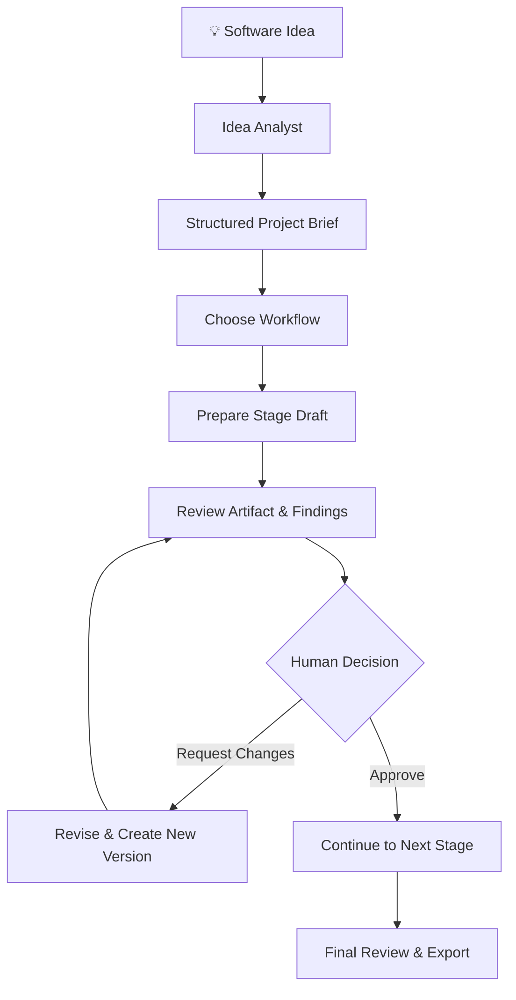
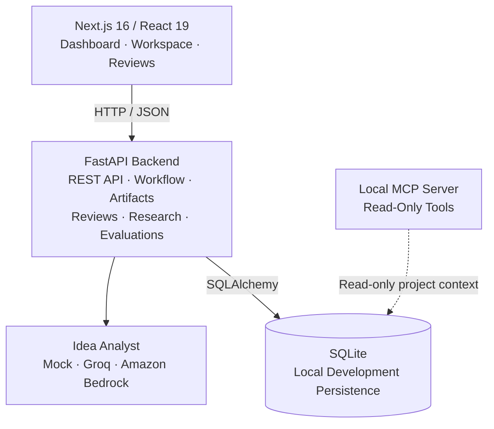

<div align="center">

# NexusFlow

### From a raw software idea to a reviewable, implementation-ready project plan.

**A local-first project planning workspace with structured idea analysis, versioned deliverables, explicit human approvals, deterministic quality checks, and a read-only MCP interface.**


[🚀 Quick Start](#-quick-start) · [🧭 How It Works](#-how-it-works) · [🏗️ Architecture](docs/NexusFlow%20Architecture%20.png) · [🗺️ Roadmap](docs/IMPLEMENTATION_PLAN.md#phase-roadmap)


</div>

---

> [!IMPORTANT]
> **Project status: local-first prototype.** NexusFlow currently has no authentication, authorization, tenant isolation, or authenticated reviewer identities. Keep the API and MCP server on trusted local interfaces. Do not expose this prototype to the public internet or use it with sensitive customer data.

## ✨ Why NexusFlow?

Turning an idea into a buildable project takes more than generating a document. Requirements need structure, decisions need a history, feedback needs to be resolved, and approvals should happen deliberately.

NexusFlow brings those steps into one workspace. It keeps project context, drafts, artifact versions, research notes, evaluation findings, and human decisions connected—creating a traceable planning history instead of a collection of disconnected documents.

### What You Can Do Today

- **Shape an idea:** Create a project and generate a structured idea brief.
- **Run a persisted workflow:** Choose a workflow template and stage sequence, then resume progress later.
- **Create and revise deliverables:** Prepare Markdown drafts and save edits as durable artifact versions.
- **Keep humans in control:** Record approvals, rejections, change requests, and revisits explicitly.
- **Review in one place:** Use the combined review queue for workflow approvals and standalone human-in-the-loop checkpoints.
- **Track research inputs:** Save participant-entered sources, findings, notes, and review status.
- **Check quality:** Run deterministic consistency and Devil's Advocate evaluations and inspect guardrail findings.
- **Export the project:** Generate a ZIP package containing the brief, workflow history, research log, feedback, and artifact versions.
- **Connect through MCP:** Optionally expose project context and artifacts through a local, read-only MCP server.

## 🧭 How It Works



### Workflow Stages

| Stage | Deliverable | Current Behavior |
|---|---|---|
| **Idea Discovery** | Idea Brief | Uses the saved structured brief; idea analysis can be run first. |
| **Market Research** | Research Plan | Builds a plan from project context and participant-entered sources; it does not browse the web. |
| **Technical Feasibility** | Technical Feasibility | Creates an initial planning draft from saved project inputs. |
| **PRD & Architecture** | Product Requirements, Architecture Outline | Creates Markdown outlines from project inputs and the brief. |
| **Quality Review** | Quality Review | Collects deterministic consistency and Devil's Advocate findings. |
| **Final Approval** | Final Package Guide | Lists saved artifacts for final human review. |

Approvals are gated by configured checks. Required deliverables must exist, content checks must pass, blocking findings and unresolved comments must be addressed, and artifacts must have newer versions after a change request.

Preparing an existing stage preserves its current artifact and reviewer edits rather than silently overwriting them.

## 🏗️ Architecture



### Technology Stack

| Layer | Technologies |
|---|---|
| Frontend | Next.js App Router, React, TypeScript, Tailwind CSS, shadcn/ui, Lucide |
| Backend | Python, FastAPI, Pydantic v2, SQLAlchemy 2 |
| Local Persistence | SQLite |
| Idea Analysis | Mock, Groq, Amazon Bedrock provider options |
| Integration | Optional local MCP Streamable HTTP server |
| Quality & Review | Deterministic evaluations, guardrails, version-linked comments, human approval gates |

The backend is organized around `api/`, `agents/`, `guardrails/`, `models/`, `schemas/`, and `services/`.

The frontend lives under `frontend/src/app/`, with reusable components in `frontend/src/components/` and typed API clients in `frontend/src/lib/`.

## 🚀 Quick Start

### Prerequisites

- Python **3.10+**
- Node.js **20.9+** and npm
- Optional: Groq API key or AWS credentials for live idea analysis

The default local setup uses a mock provider, so you can run the application without LLM credentials.

### 1. Start the Backend

From the repository root, open a terminal and run:

```bash
cd backend
cp ../.env.example .env
python3 -m venv .venv
source .venv/bin/activate
python -m pip install -r requirements.txt
uvicorn app.main:app --reload --host 127.0.0.1 --port 8000
```

Verify that the API is running:

- **Health check:** http://localhost:8000/health
- **Interactive API docs:** http://localhost:8000/docs

The local database is created at `backend/nexusflow.db` when the app is started from the `backend/` directory.

### 2. Start the Frontend

Open a second terminal from the repository root:

```bash
cd frontend
npm ci
npm run dev
```

Open **http://localhost:3000** in your browser.

The frontend uses `http://localhost:8000` by default. To change the API base URL, set `NEXT_PUBLIC_API_URL` in `frontend/.env.local` and restart the frontend.

**Security note:** Only put values safe for browser exposure in `NEXT_PUBLIC_*` variables.

### 3. Explore a Project

1. Choose **Explore with a sample** to create a saved example, or **Start your own** to enter an idea.
2. Generate the structured brief.
3. Start a workflow and prepare the current stage's draft.
4. Review the artifact, comments, and findings.
5. Approve the stage or request changes with notes.
6. Continue through the workflow, then export the project package.

The sample is created in your local database; it is not a hosted demo or preloaded fixture.

## 🤖 LLM Provider Setup

Provider settings are read by the backend from its process environment or `backend/.env`.

### Mock Provider — Default

```dotenv
LLM_PROVIDER=mock
```

Returns a predictable sample brief. No API key is required, making it useful for initial setup, UI exploration, and tests.

### Groq

Add the following to `backend/.env`:

```dotenv
LLM_PROVIDER=groq
GROQ_API_KEY=your_groq_api_key
GROQ_MODEL=openai/gpt-oss-120b
```

Restart the backend after changing configuration. Returned data is validated against the brief schema.

See the [Groq model documentation](https://console.groq.com/docs/models) for current model availability.

### Amazon Bedrock

Configure the backend environment:

```dotenv
LLM_PROVIDER=bedrock
AWS_REGION=us-west-2
BEDROCK_MODEL_ID=anthropic.claude-3-5-sonnet-20240620-v1:0
```

Provide AWS credentials through the environment or the AWS credential chain used by `boto3`. Never commit credentials. The example environment selects `mock` for a credential-free first run.

### Token Usage & Cost Notes

When the provider returns usage data, input and output token counts are recorded in Agent Runs and Metrics.

Idea analysis currently makes one model request and caps completion output at 1,200 tokens. The cost summary currently estimates Bedrock costs only; Groq cost is intentionally left blank. Parallel tool calling is not used because this flow has no independent tool calls.

## 🔌 Local MCP Server

Start the backend first, then open a third terminal:

```bash
cd backend
source .venv/bin/activate
python -m app.mcp_server
```

**Endpoint:** http://127.0.0.1:8001/mcp

The server uses Streamable HTTP and exposes three **read-only** tools:

| Tool | Purpose |
|---|---|
| `get_project_context(project_id)` | Read the project idea, brief, workflow state, and decisions. |
| `list_project_artifacts(project_id)` | List artifact names, types, versions, and update times. |
| `read_project_artifact(project_id, artifact_id)` | Read the latest artifact content after checking that it belongs to the supplied project. |

These tools cannot mutate data, approve workflow stages, create projects, or perform external research.

The server is intended for local development and has no authentication for network exposure. **A2A and external MCP server connections are not implemented.**

## ⚙️ Configuration Reference

See [`.env.example`](.env.example) for the starter configuration.

| Variable | Purpose | Example / Default |
|---|---|---|
| `APP_NAME` | Application name | `NexusFlow` |
| `APP_ENV` | Environment label | `development` |
| `DEBUG` | Debug setting | `true` |
| `BACKEND_HOST` | Configured backend host | `0.0.0.0` in settings; quick start binds to loopback |
| `BACKEND_PORT` | Backend port | `8000` |
| `DATABASE_URL` | SQLAlchemy database URL | `sqlite:///./nexusflow.db` |
| `CORS_ORIGINS` | JSON list of allowed browser origins | `["http://localhost:3000"]` |
| `LLM_PROVIDER` | `mock`, `groq`, or `bedrock` | `.env.example` uses `mock` |
| `GROQ_API_KEY` | Backend-only Groq credential | Empty unless Groq is selected |
| `GROQ_MODEL` | Groq model identifier | `openai/gpt-oss-120b` |
| `AWS_REGION` | AWS region for Bedrock | `us-west-2` |
| `BEDROCK_MODEL_ID` | Bedrock model identifier | `anthropic.claude-3-5-sonnet-20240620-v1:0` |
| `LLM_TIMEOUT_SECONDS` | Provider request timeout | `60` |
| `NEXT_PUBLIC_API_URL` | Frontend API base URL | `http://localhost:8000` |

Other SQLAlchemy database URLs may require a driver, migrations, and deployment-specific configuration. SQLite is the documented and validated local setup; a production migration workflow is not included yet.

## 🧩 API Overview

The complete request and response schemas are available in Swagger UI at **http://localhost:8000/docs**.

| Area | Representative Routes |
|---|---|
| Health | `GET /health` |
| Projects & Brief | `GET/POST /projects`, `GET/PATCH/DELETE /projects/{id}`, `/projects/{id}/idea-analysis` |
| Workflow | `/projects/{id}/workflow`, `/workflow/prepare`, `/workflow/decision`, `/review-queue/workflows` |
| Artifacts & Export | `/projects/{id}/artifacts`, artifact version routes, `/projects/{id}/package/export` |
| Research | `/projects/{id}/research-sources`, `/projects/{id}/research-plan/refresh` |
| Review & HITL | Project checkpoint routes, `/review-queue`, artifact review comment routes |
| Evaluations & Guardrails | Consistency, Devil's Advocate, and guardrail finding routes |
| Runs & Metrics | `/mlops/runs`, `/mlops/prompts`, `/mlops/cost-summary`, `/mlops/metrics` |
| Traces & Dashboard | Project trace routes, `/dashboard/stats`, `/dashboard/events/{project_id}` |

Routes generally return JSON; artifact and package export routes return downloadable files.

**The API currently does not authenticate callers or enforce user/project ownership.**

## 🧪 Tests & Build Checks

### Backend Tests

Run from `backend/` with the virtual environment active:

```bash
source .venv/bin/activate
LLM_PROVIDER=mock DATABASE_URL=sqlite:///./test-nexusflow.db pytest -q
```

This uses a separate SQLite database file so the test run does not use your normal local database. Remove the test database when it is no longer needed. Tests should not require a paid model key.

### Frontend Checks

Run from `frontend/`:

```bash
npm run lint
npx tsc --noEmit
npm run build
```

## 🔐 Security & Data Notes

- Local project data is stored in `backend/nexusflow.db` with the documented setup.
- `.env`, `.venv`, and local SQLite files are ignored by Git; `.env.example` should contain placeholders only.
- There is currently no authentication, authorization, tenant isolation, or authenticated reviewer identity.
- Keep the API and MCP server on trusted local interfaces. Do not expose ports `8000` or `8001` to the public internet.
- CORS is not authentication; it does not prevent direct calls from non-browser clients.
- Tables are initialized on application startup. Production migrations and a backup/restore workflow are not yet included.
- Keep Groq and AWS credentials in the backend environment only. If a key is exposed, revoke and rotate it.

### Troubleshooting

| Symptom | Check |
|---|---|
| Frontend cannot reach API | Confirm the backend is running, check `/health`, and verify `NEXT_PUBLIC_API_URL`. |
| Browser reports CORS errors | Check that the frontend origin is included in `CORS_ORIGINS`, then restart the backend. |
| Groq analysis fails | Check `LLM_PROVIDER`, the backend-only key, model availability, and provider connectivity. |
| Approval is blocked | Read `review_issues`, prepare the current stage, resolve comments/blocking findings, and create new artifact versions after change requests. |

## 🗺️ Roadmap

NexusFlow is being developed incrementally. Current areas for follow-up include:

- [ ] Authentication, project authorization, and authenticated reviewer identity
- [ ] Database migrations and backup/restore strategy
- [ ] Continuous integration and end-to-end browser coverage
- [ ] External research discovery with citations and explicit permission controls
- [ ] Model-aware cost estimates across providers
- [ ] Deployment and operational documentation
- [ ] Independent agent orchestration when there is a real need for collaboration across services
- [ ] A2A and external MCP integrations when their boundaries and permissions are defined

## 📚 Project Documentation

- [Architecture and current capabilities](docs/ARCHITECTURE.md)
- [Implementation plan](docs/IMPLEMENTATION_PLAN.md)
- [Product requirements](docs/PRD.md)
- [Contributing guide](CONTRIBUTING.md)

## 🤝 Contributing

Contributions, issue reports, and practical feedback are welcome. Please keep changes typed, testable, and modular, and clearly distinguish implemented behavior from planned integrations.

See [`CONTRIBUTING.md`](CONTRIBUTING.md) for project-specific guidance.

There is currently no `LICENSE` file. Until a license is added, do not assume the repository grants permission for reuse or redistribution.

---

<div align="center">

**NexusFlow** · Structured planning. Traceable decisions. Human-reviewed progress.

</div>
